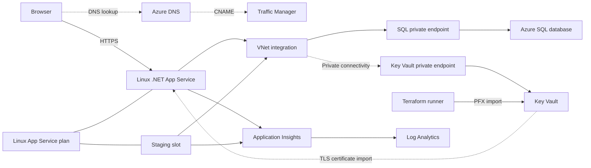

# Azure infrastructure with Terraform

This stack deploys the ASP.NET Core Todo application's Azure infrastructure using
Terraform modules.

## Architecture



Traffic Manager answers DNS queries; HTTPS traffic goes directly to App Service.
Performance routing is chosen to support directing users to the lowest-latency
healthy region as additional regional deployments are added. DNS-based routing
keeps TLS termination at App Service and requires no HTTP proxy in the request path.
This stack currently has one endpoint, so every DNS response selects the same app;
regional latency selection and failover require additional endpoints. See
[Traffic Manager routing methods](https://learn.microsoft.com/en-us/azure/traffic-manager/traffic-manager-routing-methods).

Azure Front Door would be preferable when the application needs a global HTTP(S)
reverse proxy with WAF protection, edge caching, TLS termination at the edge, or
host/path-based routing. Those requirements need processing of HTTP requests at
the edge, beyond Traffic Manager's DNS-based endpoint selection. See
[Azure Front Door](https://learn.microsoft.com/en-us/azure/frontdoor/front-door-overview).

| Module | Resources |
| --- | --- |
| [`resource-group`](modules/resource-group/) | Resource group |
| [`networking`](modules/networking/) | VNet, delegated integration subnet, private endpoint subnet, private DNS zones and VNet links |
| [`sql`](modules/sql/) | SQL logical server, application database, private endpoint and DNS zone group |
| [`app-service`](modules/app-service/) | Linux plan, web app, staging slot, Application Insights, Log Analytics workspace and Smart Detection action group |
| [`key-vault`](modules/key-vault/) | RBAC vault, private endpoint, DNS zone group and optional certificate-operator role |
| [`dns-traffic`](modules/dns-traffic/) | Traffic Manager profile, Azure endpoint and optional public DNS zone with CNAME/TXT records |
| [`certificate`](modules/certificate/) | Optional hostname binding, PFX import into Key Vault, platform certificate-read role, App Service certificate import and SNI binding |

Both app slots have separate system-assigned identities, VNet integration, HTTPS
Only, minimum application/SCM TLS 1.2 and disabled SCM/FTP basic authentication.
The default plan is Premium P0v4 with one worker and Always On disabled. Application
Insights uses App Service .NET autoinstrumentation. The Smart Detection action group
defines notification receivers for the Monitoring Contributor and Monitoring Reader
roles.

SQL is private-only and Entra-only. Both slots use a sticky, passwordless
`AZURE_SQL_DEFAULTCONNECTOR_CONNECTIONSTRING`, matching `Program.cs`. Managed-identity
authentication requires no SQL password or application secret-reader role in Key Vault.
The App Service platform identity separately reads the TLS certificate from the
vault. A private endpoint provides vault connectivity from the VNet. The Terraform
runner can use private connectivity or the vault's public endpoint with its egress
IP permitted by the firewall. Trusted Azure services can access the vault for
App Service certificate imports.

The integration subnet supplies outbound connectivity from App Service to the
private endpoints. Private DNS resolves the normal SQL/Key Vault hostnames to
endpoint addresses. Azure creates endpoint NICs and the SQL `master` database;
separate Terraform resources for these are unnecessary.

## Layout and naming

Run all commands in this README from `infra/azure`. From the repository root:

```bash
cd infra/azure
```

- `main.tf`: module composition and Azure client metadata.
- `terraform.tf`: Terraform/provider requirements, also declared in child modules.
- `providers.tf`: the shared provider configuration.
- `variables.tf`, `outputs.tf`: configuration inputs and operational outputs.
- `locals.tf`: shared values in modules that need them.
- `.terraform.lock.hcl`: selected provider version and checksums; commit this file.
- `terraform.tfvars.example`: committed configuration example.

The root constrains AzureRM to 5.13.x; child modules declare `>= 5.13.0` and inherit
the provider configuration. This single README covers the internal modules.
File naming and declarations follow the
[HashiCorp style guide](https://developer.hashicorp.com/terraform/language/style)
and [provider requirements guidance](https://developer.hashicorp.com/terraform/language/modules/develop/providers).

Top-level resource names come from the values file. Network names are derived:

| Resource | Name |
| --- | --- |
| VNet | `vnet-<web_app_name>` |
| Integration / private endpoint subnets | `app-service-integration` / `private-endpoints` |
| Private DNS VNet links | `<virtual_network_name>-link`, scoped to each zone |
| SQL / vault private endpoints | `pe-<sql_server_name>` / `pe-<key_vault_name>` |
| Log Analytics workspace | `<web_app_name>-logs` |
| Private DNS zones | `privatelink.database.windows.net`, `privatelink.vaultcore.azure.net` |

Azure generates resource IDs, managed identity principal IDs, private endpoint IPs
and NIC names. No random-name provider is needed.

## Prerequisites

- Terraform >= 1.17.1, Azure CLI, available names and regional SKU quota.
- Azure permissions to create/delete resources and assign RBAC roles. Contributor
  alone cannot create role assignments.
- Registered providers: `Microsoft.Web`, `Microsoft.Network`, `Microsoft.Sql`,
  `Microsoft.KeyVault`, `Microsoft.Insights` and `Microsoft.OperationalInsights`.
  Automatic provider registration is disabled.
- For custom HTTPS: domain delegation control, an existing PFX including its private
  key/chain, and vault connectivity from the Terraform runner.

## Variables

Required root inputs:

| Input | Purpose |
| --- | --- |
| `subscription_id`, `resource_group_name` | Deployment subscription and group |
| `web_app_name`, `service_plan_name` | App and Linux plan names |
| `sql_server_name`, `sql_database_name` | SQL server and application database names |
| `sql_entra_admin_login_name`, `sql_entra_admin_object_id` | Entra administrator display name and object ID, not a client ID |
| `key_vault_name` | Available vault name, at most 24 characters |
| `application_insights_name`, `action_group_name` | Monitoring resource names |
| `traffic_manager_name`, `traffic_manager_endpoint_name` | Profile/DNS label and Azure endpoint name |

Optional root inputs:

| Input | Default / purpose |
| --- | --- |
| `location` | `canadacentral` |
| `service_plan_sku_name` | `P0v4`; the full stack requires a tier supporting slots |
| `dotnet_version`, `staging_slot_name` | `10.0`, `staging` |
| `sql_database_sku_name` | `GP_Gen5_2`; database maximum size is 32 GiB |
| `vnet_address_space` | `10.0.0.0/16` |
| `integration_subnet_cidr` | `10.0.1.0/24` |
| `private_endpoint_subnet_cidr` | `10.0.2.0/24` |
| `log_retention_days` | `30` for Log Analytics; Application Insights uses 90 days |
| `custom_domain` | `null`; otherwise zone name, record name (default `www`), binding switch (default `false`) and optional TLS settings |
| `certificate_name` | `null`; App Service certificate name defaults to `<web_app_name>-custom-tls` |
| `certificate_password` | Empty string; sensitive PFX export password supplied through `TF_VAR_certificate_password` |
| `operator_ipv4_cidrs` | `[]`; public IPv4 CIDRs allowed through the vault firewall |
| `certificate_operator_object_id` | `null`; with TLS settings, defaults to the authenticated Terraform identity |

The tenant ID is derived from the provider context. Use administrator/platform
object IDs from that tenant. Subnet CIDRs must fit inside the VNet and not overlap.
The app, SQL server, vault and Traffic Manager DNS names must be globally available.

If no local values file exists, copy the example and edit it:

```bash
cp terraform.tfvars.example terraform.tfvars
```

The example enables custom HTTPS and supplies generic names and the reserved domain
`example.com`. Replace the identity, public IP, domain and PFX placeholders, choose
available names, and supply the PFX password through `TF_VAR_certificate_password`
before planning.

The root `.gitignore` excludes local values, state/backups, `.terraform/`, override
files and PFX files. Commit source, this README, `.example` files and the lock file.

## Initialize, plan and apply

```bash
az login
az account set --subscription YOUR_AZURE_SUBSCRIPTION_ID
terraform init
terraform fmt -check -recursive
terraform validate
terraform plan
terraform apply
terraform output
```

You can set `custom_domain.enable_binding = true` for the first apply when the TLS
settings are supplied and registrar delegation matches the zone's assigned name
servers. The certificate module requires PFX settings whenever it is enabled.
If delegation is not ready, apply with binding disabled, complete delegation, then
enable binding. Azure assigns name servers from a pool when a zone is created;
the App Service region does not guarantee that a recreated zone gets the same set.
`apply` produces a fresh plan and asks for confirmation; review it before approving.
No saved-plan file is required.

If direct Premium plan creation stalls, create only the plan at Basic, then run a
full apply to upgrade it and create the remaining resources:

```bash
terraform apply \
  -target=module.app_service.azurerm_service_plan.this \
  -var='service_plan_sku_name=B1'
terraform apply
```

Use targeting only for this creation workaround. A full Basic-tier deployment
cannot create the staging slot. Keep the normal Premium value in your values file.

## Database authentication progression

The database connection follows the three stages described in the
[App Service and Azure SQL tutorial](https://learn.microsoft.com/en-us/azure/app-service/tutorial-dotnetcore-sqldb-app#3-secure-connection-secrets):

1. **SQL username and password.** The wizard creates `AZURE_SQL_CONNECTIONSTRING`
   in App Service with SQL credentials in its value. Placeholder example:

   ```text
   Server=tcp:<server>.database.windows.net,1433;Database=<database>;User ID=<sql-user>;Password=<sql-password>;Encrypt=True;TrustServerCertificate=False;
   ```

2. **SQL secret in Key Vault.** Store the password-bearing connection string as a
   Key Vault secret and replace the App Service value with a reference. App Service
   resolves it using its managed identity with secret-read access; SQL still uses
   the password. Placeholder reference:

   ```text
   @Microsoft.KeyVault(SecretUri=https://<vault>.vault.azure.net/secrets/<sql-connection-secret>)
   ```

   See [App Service Key Vault references](https://learn.microsoft.com/en-us/azure/app-service/app-service-key-vault-references).

3. **Passwordless managed identity.** Each slot authenticates directly to SQL with
   its system-assigned identity and a matching database user. The current application
   reads `AZURE_SQL_DEFAULTCONNECTOR_CONNECTIONSTRING`:

   ```text
   Server=tcp:<server>.database.windows.net,1433;Database=<database>;Authentication=Active Directory Managed Identity;Encrypt=True;TrustServerCertificate=False;
   ```

Terraform configures the third stage's managed identities and passwordless connection
settings. Database-user provisioning and application deployment are separate from
infrastructure provisioning. There is no SQL password or database connection secret
to store or rotate. Key Vault continues to hold the TLS certificate.

## Database access

After a fresh deployment, run [sql.sh](../../scripts/sql.sh) to create database users
and permissions for the production and staging managed identities. Sign in as the
configured SQL Entra administrator. The runner requires unixODBC and Microsoft ODBC
Driver 18 for SQL Server.

From `infra/azure`, replace the placeholders and run:

```bash
bash ../../scripts/sql.sh \
  "<subscription-id>" \
  "<resource-group>" \
  "<app-name>" \
  "<sql-server-name>" \
  "<database-name>"
```

The optional sixth argument selects the slot; it defaults to `staging`. The script
temporarily enables public SQL access and restores private-only access on exit.
Connection settings remain managed by Terraform.

## Application deployment

[azure-pipelines.yml](../../azure-pipelines.yml) builds and tests the application,
deploys to staging, and runs database migrations through
[run-migrations.sh](../../scripts/run-migrations.sh). After successful checks, it
swaps staging into production and verifies the application.

Before running the pipeline:

- Complete [database access setup](#database-access) for both managed identities.
- Use a Linux agent with Azure CLI >= 2.90 in the configured pool.
- Set `azureServiceConnection`, `resourceGroupName`, `webAppName` and `slotName`
  in YAML. Authorize the service connection for the pipeline and grant its identity
  deployment access, including SCM access and slot swaps.

After deployment, verify the application over HTTPS and create a Todo item to
confirm database access and persistence.

## DNS and certificates

The project uses a custom domain in the free
[`.pp.ua` domain zone](https://nic.ua/en/knowledge-base/pp-ua-domains-restrictions),
with a `www` hostname for the application. Domain registration is managed through
the registrar, and authoritative DNS is delegated to Azure DNS.

The custom hostname uses a free 90-day [ZeroSSL certificate](https://zerossl.com/features/certificates),
imported as a PFX into Key Vault and then into App Service for the TLS binding.

The example configures `www.example.com` through Traffic Manager; use your own domain:

1. Check that registrar delegation matches all four name servers assigned to the
   zone. If it already matches, no registrar update is needed and binding can be
   enabled from the first apply. If delegation is not ready, apply with binding
   disabled, read `terraform output custom_domain`, and update
   the registrar as needed. Verify the public `www` CNAME and `asuid.www` TXT records.
   See [Azure DNS name-server assignment](https://learn.microsoft.com/en-us/azure/dns/dns-delegate-domain-azure-dns#retrieve-name-servers).
2. Keep the PFX outside the repository. Use Microsoft's public App Service
   application ID to look up the platform object ID for
   `app_service_principal_object_id`:

   ```bash
   az ad sp show --id abfa0a7c-a6b6-4736-8310-5855508787cd --query id -o tsv
   ```

3. Add certificate settings to your local values file:

   ```hcl
   operator_ipv4_cidrs = ["YOUR_PUBLIC_IPV4/32"]

   custom_domain = {
     zone_name      = "example.com"
     record_name    = "www"
     enable_binding = true
     tls_certificate = {
       key_vault_certificate_name      = "example-com"
       pfx_file_path                   = "/absolute/path/to/certificate.pfx"
       app_service_principal_object_id = "APP_SERVICE_RESOURCE_PROVIDER_OBJECT_ID"
     }
   }
   ```

   The public IP allowlist must match the runner's egress IP, or the runner must
   have private vault connectivity and DNS. Terraform creates the certificate
   permissions before importing and binding the certificate.
4. Supply the PFX export password in the same terminal used to run Terraform:

   ```bash
   read -r -s -p "PFX password (empty if unprotected): " TF_VAR_certificate_password
   printf '\n'
   export TF_VAR_certificate_password
   terraform plan
   terraform apply
   unset TF_VAR_certificate_password
   ```

Terraform imports the PFX into Key Vault, grants the App Service platform certificate
read access, imports the certificate into App Service and creates the SNI binding.
The vault permits trusted Azure services for this operation. Terraform dependencies
order resource creation but do not wait for public DNS caches or RBAC propagation.
If an apply fails because DNS or permissions are not ready, resolve that condition
and rerun the full apply with binding still enabled. A separate binding-disabled
apply is an optional preparation step, not a requirement.
See [App Service certificates from Key Vault](https://learn.microsoft.com/en-us/azure/app-service/configure-ssl-certificate#import-a-certificate-from-key-vault).

Verify HTTPS on the custom hostname. Keep binding enabled for normal updates.
For renewal, obtain a renewed PFX, update the local file/path and plan/apply with its
password. Keep the PFX available for subsequent Terraform operations. Certificate
issuance and renewal scheduling remain external.

AzureRM stores PFX contents and the supplied password in Terraform state despite
sensitive CLI redaction.

## Destroy

The configuration currently uses local state under `infra/azure`. Retain that state
and the required inputs/credentials for updates and teardown. For shared or CI use,
configure a protected remote backend outside the application resource group's
lifecycle before provisioning.

```bash
terraform plan -destroy
terraform destroy
```

Review the fresh destroy plan before approving. Destroy removes managed resources
and application data; a subsequent apply creates an empty database and new app
identities.

Key Vault soft deletion retains the vault and its contents for 90 days. This provider
neither purges nor recovers them automatically. Reuse requires a new name, expiry of
retention, or an explicit portal purge. See [Key Vault soft deletion](https://learn.microsoft.com/en-us/azure/key-vault/general/soft-delete-overview).

Registrar delegation, certificate issuer accounts, GitHub/Azure DevOps setup,
external runners and pre-existing shared workspaces are outside this stack. Update
or remove registrar delegation separately if retiring the domain.

## Verification

Verify the infrastructure deployment with:

- Reviewed Terraform plan and successful apply output.
- Public DNS resolution through Traffic Manager and HTTPS on the custom hostname.
- Successful Terraform destroy output when removing the stack.
